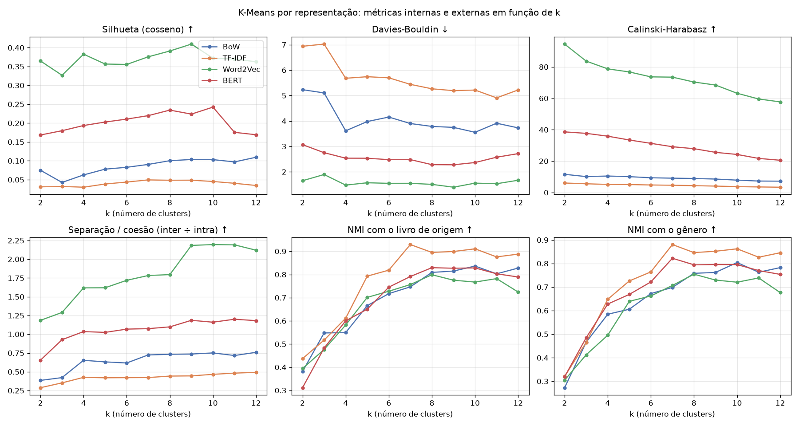
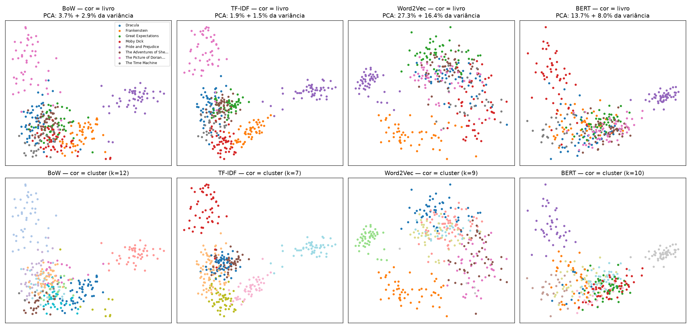
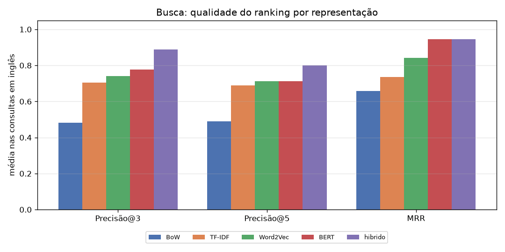
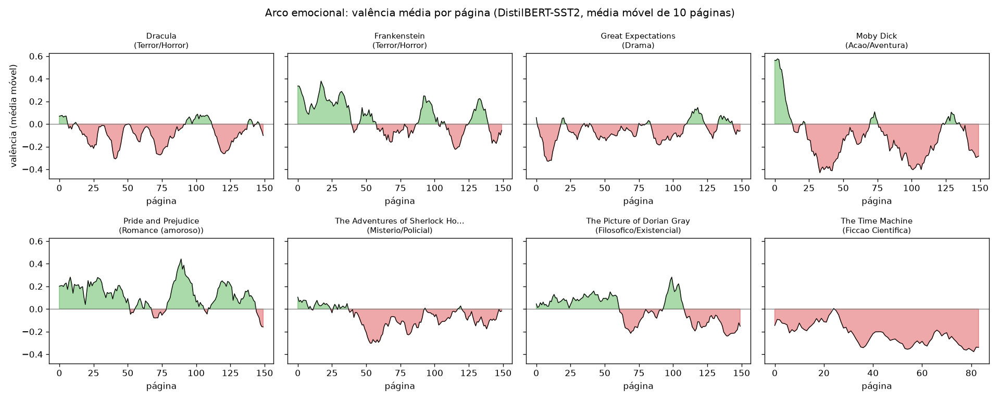
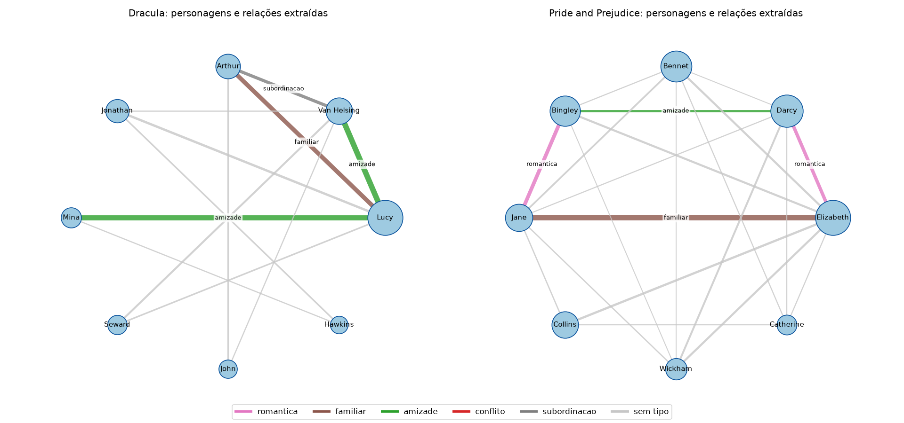

# Trabalho da Unidade 3: representações textuais × tarefas de PLN

**Processamento de Linguagem Natural, 2026/2 (FURB)**
Equipe: Pedro Rafael, Leonardo Dal'Olmo, Marlon Moser e Rafael Ehlert
Projeto: *Librarian AI*, classificação de gênero literário por amostragem parcial de páginas (Unidade 1)

> Todo o código desta etapa está nesta pasta (`unidade3/`). Os números, tabelas e
> figuras citados abaixo são gerados por `python -m unidade3.run` e ficam em
> [`results/`](results/). Cada etapa tem um resumo próprio com **todas** as
> tabelas: [clusterização](results/01_clusterizacao.md), [busca](results/02_busca.md),
> [recomendação](results/03_recomendacao.md), [classificação](results/04_classificacao.md) e
> [sentimento/NER/relações](results/05_extracao.md).

## Dados utilizados

| Conjunto | Obras | Páginas úteis | Documentos | Uso |
|---|---|--:|--:|---|
| **Base** (Etapa 2) | Dracula, Frankenstein, Pride and Prejudice, The Adventures of Sherlock Holmes, Moby Dick, Great Expectations, The Picture of Dorian Gray, The Time Machine | 1.134 | 378 | todas as tarefas |
| **Holdout** (novo) | Dr Jekyll and Mr Hyde, Jane Eyre, The Mysterious Affair at Styles, Treasure Island, Little Women, Siddhartha, The War of the Worlds | 904 | 302 | só como **dados novos** (classificação) e no acervo de recomendação |

- **Amostragem (explicitada, como o enunciado permite):** de cada livro usamos as
  primeiras 150 páginas do PDF gerado na Etapa 2 (*The Time Machine* tem 84 e *Jekyll*, 70).
- **Unidade de análise (documento):** bloco de 3 páginas consecutivas (~7 mil caracteres).
  Uma página sozinha é curta e ruidosa, e o livro inteiro dá só 8 pontos para agrupar.
- **Rótulos:** gênero **curado manualmente** por obra (`src/librarian_ai/catalog.py`). O
  gabarito das APIs da Etapa 2 é ruidoso demais para treino (*Pride and Prejudice* sai como
  "Drama" no Open Library).
- **Por que um holdout:** a base tem **um livro por gênero** (só terror tem dois). Validar
  com documentos do mesmo livro mede se o modelo reconhece *aquele livro*, não o gênero.
  Para responder "como ele se comportou com dados novos", baixamos 7 obras inéditas, uma por
  gênero, de autores diferentes sempre que possível (a exceção é Wells, autor de *The War
  of the Worlds* e de *The Time Machine*).

### As quatro representações (`representations.py`)

| | Vetor do documento | Ajuste |
|---|---|---|
| **BoW** | contagem dos termos (tokens de 3+ letras, sem stopwords PT/EN, `min_df=2`) | vocabulário do treino |
| **TF-IDF** | TF sublinear (1 + log tf) × IDF, normalizado | vocabulário + IDF do treino |
| **Word2Vec** | média dos vetores das palavras **ponderada pelo IDF**; skip-gram de 100 dimensões treinado no próprio corpus (gensim, semente fixa) | treino do Word2Vec |
| **BERT** | Sentence-BERT `all-MiniLM-L6-v2` (BERT de 6 camadas): janelas de 180 palavras → *mean pooling* → média ponderada das janelas | nada, é pré-treinado |

Todas implementam `fit`/`transform`, e o `fit` só vê textos de treino. Antes de
agrupar, buscar ou comparar, os vetores são normalizados (norma L2 = 1), de modo que
todas as tarefas operam na geometria do cosseno:

```python
class Word2VecRepresentation(Representation):
    def transform(self, texts):
        ...
        counts = Counter(w for w in analyze(text) if w in wv.key_to_index)
        weights = np.array([counts[w] * self.idf.get(w, 1.0) for w in words])
        out[i] = weights @ wv[words] / weights.sum()   # média ponderada pelo IDF
```

---

## 1) Atividades realizadas

|  | BoW | TF-IDF | Word2Vec | BERT |
|---|:--:|:--:|:--:|:--:|
| **Clusterização + PCA e visualização** | ✔️ | ✔️ | ✔️ | ✔️ |
| **Busca e recomendação** | ✔️ | ✔️ | ✔️ | ✔️ |
| **Classificação** | ✔️ | ✔️ | ✔️ | ✔️ |

| Tarefa | |
|---|---|
| Análise de sentimento | ( **X** ) Foi realizada ( ) Não foi realizada |
| Reconhecimento de Entidades Nomeadas | ( **X** ) Foi realizado ( ) Não foi realizado |
| Extração de Relações | ( **X** ) Foi realizada ( ) Não foi realizada |

Além das quatro representações, também foram usados: busca **híbrida** (TF-IDF + BERT por
*Reciprocal Rank Fusion*), classificação **zero-shot por NLI** (`facebook/bart-large-mnli`,
o classificador do pipeline da Unidade 1) e o **léxico TF-IDF** do pipeline, ambos como
referência sem treino.

---

## 2) Clusterização: qual representação gera clusters mais representativos?

K-Means (10 inicializações) com k de 2 a 12 sobre os 378 documentos da base. Métricas
**internas**: silhueta (cosseno), Davies-Bouldin, Calinski-Harabasz, coesão (*intra*:
distância média ao próprio centroide) e separação (*inter*: distância média entre
centroides). Métricas **externas**: pureza, ARI e NMI em relação ao livro e ao gênero de
origem (`clustering.py`).



**Melhor k pela silhueta** (o critério interno, que não olha rótulos):

| Representação | k | Silhueta | Davies-Bouldin ↓ | Calinski-H. | Intra | Inter | Inter/Intra | Pureza (livro) | NMI (livro) | NMI (gênero) |
|---|--:|--:|--:|--:|--:|--:|--:|--:|--:|--:|
| BoW | 12 | 0,109 | 3,73 | 7,2 | 0,81 | 0,62 | 0,76 | 0,92 | 0,83 | 0,78 |
| TF-IDF | 7 | 0,049 | 5,44 | 4,6 | 0,92 | 0,39 | 0,42 | 0,91 | **0,93** | **0,88** |
| Word2Vec | 9 | **0,409** | **1,39** | **68,4** | **0,22** | 0,49 | **2,18** | 0,86 | 0,78 | 0,73 |
| BERT | 10 | 0,242 | 2,36 | 24,2 | 0,52 | 0,60 | 1,16 | 0,90 | 0,83 | 0,80 |



**Interpretação das métricas intra e intercluster.** Pelas métricas internas, o Word2Vec
"ganha" com folga: clusters compactos (intra 0,22), separação duas vezes maior que a coesão
e silhueta de 0,41. O TF-IDF fica no extremo oposto: intra de 0,92 (perto do máximo para
vetores unitários quase ortogonais) e silhueta de 0,05. Isso, porém, é um efeito da
**geometria** de cada espaço, e não da qualidade semântica dos grupos. Em 11.816 dimensões
esparsas, quase todos os pares de documentos são quase ortogonais e as distâncias se
concentram (a "maldição da dimensionalidade"). O PCA mostra o mesmo: os dois primeiros eixos
explicam só 3,4% da variância do TF-IDF, contra 43,7% do Word2Vec. Já a média de vetores do
Word2Vec comprime cada documento num espaço denso de 100 dimensões, onde tudo fica próximo
de tudo. **Silhueta e Davies-Bouldin servem para escolher k dentro de uma representação, mas
não para comparar representações entre si.**

**Leitura qualitativa (termos distintivos e documento medoide de cada cluster).** Quando
comparamos com o que se sabe dos dados, a ordem se inverte. O TF-IDF com k = 7 tem a maior
NMI com o livro (0,93) e com o gênero (0,88): cada cluster é praticamente um livro
(*holmes, sherlock, watson, street, case*; *dorian, gray, harry, basil*; *whale, queequeg,
ship, captain, sea*). A única fusão relevante junta *Dracula* e *The Time Machine*
(cluster 1). Três observações vieram da leitura dos clusters:

- **Os clusters reproduzem livros, e os nomes de personagens são o que mais pesa.** Em todas
  as representações os termos distintivos são dominados por nomes próprios. Como a base tem
  um livro por gênero, "agrupar por livro" e "agrupar por gênero" quase coincidem. O teste
  real é o terror, o único gênero com dois livros: **nenhuma** representação juntou
  *Dracula* e *Frankenstein* num mesmo cluster.
- **O BERT é o único que formou um cluster temático entre livros.** O cluster 1 do BERT
  (k = 10) junta 16 documentos de *Dracula* e 12 de *Moby Dick*, com os termos *count, bed,
  castle, landlord, harpooneer, sleep, wolves*. São as cenas de "pernoite num lugar
  estranho": Harker no castelo do Conde e Ishmael na estalagem do Spouter-Inn. Nenhuma das
  representações baseadas em palavras capturou essa semelhança de **situação narrativa**.
- **Clusters de ruído estrutural.** O BoW (cluster 9) e o Word2Vec (cluster 6) isolam as
  páginas de sumário e de abertura (*chapter, heading, contents, etymology*). É exatamente o
  conteúdo que o agente da Unidade 1 deveria aprender a evitar.

**Quantos clusters?** As curvas de NMI de todas as representações sobem até k ≈ 7–8 e
estabilizam (painéis inferiores da figura). **k = 7 a 8 (o número de gêneros e de livros) é
a quantidade que melhor expressa as características originais dos dados.** Valores maiores
só subdividem livros, embora em segmentos narrativos reais: com k = 12, o BoW separa
*Great Expectations* em "Joe, a forja e o Sr. Wopsle" e "Miss Havisham e Estella", e
*The Time Machine* na moldura (o laboratório, o *Psychologist*, o *Editor*) e no mundo
futuro (Weena, Morlocks, a Esfinge).

**Conclusão da questão 2:** o **TF-IDF** gerou os clusters mais representativos e mais
interpretáveis para estes dados. O **BERT** foi o único a revelar semelhança temática entre
livros diferentes. O **Word2Vec** tem as melhores métricas internas, mas mistura mais os
livros (um dos seus clusters reúne documentos de 7 obras).

---

## 3) Busca: qualidade do top-3 e do top-5

Dez consultas em linguagem natural, cada uma descrevendo uma cena de uma obra específica
(ou, na consulta 9, um gênero). Documento relevante = documento da obra (ou do gênero)
descrita. Para cada resultado, `best_sentence` mostra a frase com mais termos da consulta,
o que permite julgar a relevância lendo o texto. O ranking usa o cosseno, e o **híbrido**
funde os rankings do TF-IDF e do BERT por *Reciprocal Rank Fusion* (`search.py`):

```python
def reciprocal_rank_fusion(rankings, k=60):
    score = {}
    for ranking in rankings:
        for pos, doc in enumerate(ranking, start=1):
            score[doc] = score.get(doc, 0.0) + 1.0 / (k + pos)
    return sorted(score, key=lambda d: (-score[d], d))
```



| Método (média nas 9 consultas em inglês) | P@3 | P@5 | MRR |
|---|--:|--:|--:|
| BoW | 0,48 | 0,49 | 0,66 |
| TF-IDF | 0,70 | 0,69 | 0,74 |
| Word2Vec | 0,74 | 0,71 | 0,84 |
| BERT | 0,78 | 0,71 | 0,94 |
| **Híbrido (TF-IDF + BERT)** | **0,89** | **0,80** | **0,94** |

**Análise crítica (exemplos tirados de [`results/02_busca.md`](results/02_busca.md)):**

- **BoW** é dominado por palavras frequentes. Para *"a proud rich gentleman proposes marriage
  and is refused"*, devolveu quatro trechos de *Great Expectations* ("Havisham was very rich
  and very proud") e um de *Dorian Gray*: P@5 = 0.
- **TF-IDF** acerta quando a consulta tem termos raros e específicos (*convict, marshes*:
  P@5 = 1,0), mas cai em **casamentos lexicais espúrios**. Para *"a vampire who drinks human
  blood and sleeps in a coffin"*, não trouxe nenhum trecho de *Dracula* no top-5, porque a
  palavra *vampire* quase não aparece nas primeiras 150 páginas (ela nem entrou no
  vocabulário do Word2Vec, que exige 3 ocorrências), e *coffin* casou com *Miriam Coffin or
  the Whale Fisherman* e com **Peter Coffin**, o estalajadeiro de *Moby Dick*.
- **Word2Vec** generaliza por vizinhança semântica (*whale → sperm, ocean, overboard*;
  *portrait → painter, sitter, picture*), mas a média de vetores dilui cenas específicas.
  Em *"fear and dread in the dark night"* (consulta por gênero), 4 dos 5 resultados vieram
  de *The Time Machine* (*"the fear of the little Upperworld people"*, *"fear had not yet
  left the world"*). Pelo critério automático o P@5 é 0,2, mas os trechos **falam de medo
  no escuro**: aqui o critério "ser de um livro de terror" subestima a busca.
- **BERT** tem o melhor MRR (0,94): o primeiro resultado quase sempre está certo e responde à
  **cena**, não às palavras. Na proposta de casamento, trouxe *"this offer of marriage you
  have refused?"* e *"by refusing your hand"*. Ele erra quando a consulta depende de termos
  específicos: em *"poor orphan boy helps an escaped convict in the marshes"*, o primeiro
  resultado foi o esqueleto do *"poor little Indian"* de *Moby Dick* (P@5 = 0,2, contra 1,0
  do TF-IDF).
- **Híbrido:** como TF-IDF e BERT erram em consultas **diferentes**, a fusão corrige os dois
  e eleva o P@3 de 0,78 para 0,89. Esta é a resposta empírica à pergunta "como poderiam ser
  combinados".
- **Consulta em português** (*"caça à baleia branca com arpões em alto-mar"*): BoW e TF-IDF
  casam o "mar" de *alto-mar* com o verbo inglês ***to mar*** (*"would mar his body"*), um
  falso cognato. O BERT acerta *Moby Dick* em 2 de 5, mas só porque recupera páginas de
  **sumário** ("CHAPTER 96") cujos títulos têm *whale*. Contamos como relevante pelo
  critério automático, mas para o usuário é inútil.

**Os resultados são utilizáveis em contexto real?** Para localizar um trecho dentro de um
acervo conhecido e em inglês, o **híbrido** é utilizável: em média, 89% dos 3 primeiros
resultados são da obra certa, e o primeiro resultado é da obra certa em 8 das 9 consultas
(MRR 0,94). Com ressalvas: (i) blocos de 3 páginas são grandes demais
para apontar a passagem exata; (ii) a busca não funciona entre idiomas; (iii) a relevância
aqui é "ser da obra certa", um critério mais leniente que "responder à consulta".
**Melhorias:** trechos menores (parágrafos), reordenação com *cross-encoder*, modelo
multilíngue (`paraphrase-multilingual-MiniLM` ou o mDeBERTa sugerido no README do
pipeline), BM25 no lugar do TF-IDF, expansão de consulta com os vizinhos do Word2Vec e
filtro de sumários e páginas de rosto.

### Recomendação

Sobre o **acervo** (base + holdout: 15 livros, cada gênero com pelo menos dois), o vetor
do livro é a média dos seus documentos, e a recomendação é o livro mais próximo:

| Representação | Acerto@1 (recomendado é do mesmo gênero) | Acerto@3 | "Mais como este" P@5 (trechos de *outros* livros) |
|---|--:|--:|--:|
| BoW | **0,53** | 0,60 | 0,21 |
| TF-IDF | 0,47 | 0,67 | 0,21 |
| Word2Vec | 0,47 | **0,80** | **0,33** |
| BERT | 0,40 | 0,73 | 0,22 |


Os pares *Moby Dick ↔ Treasure Island* e *The Time Machine ↔ The War of the Worlds* são
recomendados mutuamente em todas as representações. Há erros que fazem sentido: para
*Dr Jekyll and Mr Hyde* (terror), o TF-IDF e o Word2Vec recomendam *Sherlock Holmes*, e a
novela de fato é estruturada como uma investigação do advogado Utterson. O defeito mais
visível é o **hubness**: alguns livros (*Dracula* no TF-IDF, *Jane Eyre* no Word2Vec e no
BERT) aparecem como vizinhos de quase todos os outros, um fenômeno conhecido de espaços
vetoriais de alta dimensão (mitigável com centralização dos vetores ou CSLS).

---

## 4) Classificação: foi possível treinar? Como se comporta com dados novos?

**Sim.** Treinamos **regressão logística** (modelo linear) e **Random Forest** (modelo de
decisão, um *ensemble* de árvores), ambos com `class_weight="balanced"`, sobre cada
representação. Usamos dois protocolos (`classification.py`):

1. **Validação cruzada estratificada (5 folds) na base:** os documentos de um mesmo livro
   caem no treino e no teste.
2. **Holdout:** treino na base inteira e teste nos 302 documentos dos 7 livros novos. As
   representações são ajustadas **só** na base, então nem o vocabulário, nem o IDF, nem o
   Word2Vec veem o holdout. O veredito por livro agrega as distribuições dos seus documentos
   com `aggregation.aggregate`, a mesma função que o pipeline usa entre gerações.

Também testamos o **mascaramento de nomes próprios**: palavras que quase sempre aparecem
capitalizadas no meio da frase (Harker, Darcy, Mr. Collins) viram "X", detectadas livro a
livro e sem modelo (`preprocess.proper_noun_vocabulary`).


| Representação | Modelo | Nomes masc. | Acc. CV | Acc. holdout | F1 holdout | Livros novos certos (top-1) |
|---|---|:--:|--:|--:|--:|--:|
| BoW | Reg. logística | não | 0,997 | 0,477 | 0,445 | 4/7 |
| TF-IDF | Reg. logística | não | **1,000** | 0,497 | **0,452** | 4/7 |
| TF-IDF | Reg. logística | **sim** | 0,995 | 0,500 | 0,448 | **5/7** |
| Word2Vec | Reg. logística | não | 0,942 | **0,507** | 0,438 | **5/7** |
| BERT | Reg. logística | não | 0,966 | 0,414 | 0,385 | **5/7** |
| BERT | Reg. logística | sim | 0,918 | 0,417 | 0,395 | 3/7 |
| TF-IDF | Random Forest | não | 0,974 | 0,421 | 0,404 | 3/7 |
| BERT | Random Forest | não | 0,966 | 0,364 | 0,349 | 4/7 |
| *Léxico TF-IDF (pipeline, sem treino)* | — | — | — | 0,381 | 0,368 | 4/7 |
| *Zero-shot BART-MNLI (pipeline, sem treino)* | — | — | — | 0,209 | 0,188 | 2/7 |

(As 16 configurações supervisionadas estão em [`results/04_classificacao.md`](results/04_classificacao.md).)


**Como se comportou com dados novos.** Há uma **queda de ~50 pontos**: de 94–100% na
validação cruzada para 36–51% por documento nos livros novos (o acaso, com 7 gêneros,
fica em 14%). No nível do livro, os melhores modelos acertam **5 de 7** obras inéditas.
*Treasure Island* e *The War of the Worlds* são classificados corretamente pelas 16
configurações; *The Mysterious Affair at Styles*, por 11 delas. O erro sistemático é
*Siddhartha* (filosófico), previsto como terror por **todas** as configurações
supervisionadas: o único exemplo de "filosófico" no treino é *Dorian Gray*, um romance de
salão londrino que não se parece em nada com a busca espiritual de Siddhartha. *Jane Eyre*
(romance) também tende a sair como terror, e a obra de fato tem forte componente gótico
(o Quarto Vermelho, a mulher no sótão de Thornfield).

**Por que a validação cruzada engana.** Os termos de maior peso da regressão logística
sobre TF-IDF mostram o que o modelo aprendeu:

| Gênero | Sem mascarar nomes | Com nomes mascarados |
|---|---|---|
| Romance | bennet, bingley, darcy, elizabeth, jane, collins… | herself, ladies, sisters, daughters, agreeable, girls, party, **ball** |
| Mistério | holmes, sherlock, watson, street, case, police… | street, case, police, remarked, doctor, matter, visitor, singular |
| Filosófico | dorian, gray, henry, harry, basil, lord… | art, life, **portrait**, picture, wonderful, painter, charming |
| Terror | lucy, helsing, van, arthur, count, jonathan, mina… | whilst, sleep, diary, heart, castle, **death** |

Sem a máscara, o classificador é um **detector de personagens**: ele acerta 100% em
documentos de livros conhecidos e não tem como transferir isso para um livro novo. Com a
máscara, os termos passam a descrever o gênero, e o TF-IDF com regressão logística sobe de
4 para 5 livros novos certos. A máscara **não** ajuda o BERT (cai de 5 para 3): ele já
codifica o contexto, e trocar nomes por "X" degrada as frases que recebe.

**Alguma representação favorece classificações mais precisas?** Sim:
- **TF-IDF e Word2Vec com modelo linear** são as melhores combinações em dados novos (F1
  0,45 e 0,44; acurácia de até 0,51). O TF-IDF tem a vantagem de ser interpretável e de
  melhorar com a máscara de nomes.
- **O BERT não lidera** com 378 exemplos. Os embeddings de sentença (MiniLM) foram treinados
  para similaridade semântica, não para estilo ou gênero, e um classificador linear em cima
  deles tem pouca informação para separar 7 gêneros. Ainda assim, ele empata em livros
  certos (5/7).
- **O BoW** perde para o TF-IDF sempre que há livros novos: sem o IDF, palavras frequentes
  dominam.
- **O modelo de decisão (Random Forest)** teve acurácia menor que o linear no holdout em
  **todas** as 8 combinações (de 0,6 a 11 pontos), apesar da validação cruzada
  equivalente. As
  árvores escolhem poucos atributos muito discriminativos, justamente os nomes próprios, e
  sobreajustam.

**Técnicas com modelos de linguagem e de decisão.** Usamos (i) **BERT** como extrator de
características (MiniLM com *mean pooling*) para regressão logística e Random Forest;
(ii) **classificação zero-shot por NLI** com `bart-large-mnli`, o backend do pipeline da
Unidade 1, com a calibração contextual e o *sharpening* configurados no pipeline; e
(iii) **Random Forest** como modelo de decisão. O zero-shot, que não precisa de treino,
teve o pior desempenho: 224 dos 302 documentos foram rotulados como terror
([matriz](results/figuras/classificacao_confusao_zeroshot.png)), o mesmo **colapso de
modo** documentado no README do pipeline. Ainda assim, foi o **único** método a acertar
*Siddhartha*, porque julga o texto contra a descrição do gênero e não contra exemplos de
treino. O backend por LLM (Claude via API) existe no pipeline, mas não foi executado
nesta etapa por exigir chave de API paga.

---

## 5) Sentimento, entidades nomeadas e relações são aplicáveis?

Todos os três foram aplicados aos 8 livros da base com modelos BERT pré-treinados, sem
nenhum rótulo do corpus (`extraction.py`).

### Análise de sentimento — aplicável, com ressalvas

DistilBERT ajustado no SST-2, aplicado frase a frase. A valência de cada página é
P(positivo) − P(negativo), com média sobre as frases.



| Livro | Gênero | Valência média | Páginas negativas |
|---|---|--:|--:|
| The Time Machine | Ficção científica | −0,22 | 81% |
| Moby Dick | Ação/aventura | −0,12 | 68% |
| Dracula | Terror | −0,08 | 66% |
| Sherlock Holmes | Mistério | −0,07 | 58% |
| Great Expectations | Drama | −0,06 | 61% |
| Dorian Gray | Filosófico | −0,01 | 56% |
| Frankenstein | Terror | +0,05 | 45% |
| Pride and Prejudice | Romance | **+0,12** | **32%** |

O resultado é coerente nos extremos: o romance é o livro mais positivo, e a viagem a um
futuro decadente é o mais negativo. Os **arcos** mostram estrutura narrativa. *Dorian Gray*
é positivo até a página ~60 e negativo depois. *Frankenstein* começa positivo, com as
cartas de Walton e a infância feliz de Victor nas primeiras páginas da amostra. Mas a
valência **não separa gêneros sozinha** (*Frankenstein*, de terror, é mais positivo que
*Sherlock Holmes*), e há limitações claras: o modelo foi treinado em críticas de cinema, não
capta a ironia de Austen e se confunde com a linguagem do século XIX. As primeiras páginas
de *Moby Dick* saem muito positivas, mas não são narrativa: são o sumário (~9 páginas de
títulos de capítulos) e as seções *Etymology* e *Extracts*. **Uso possível:** como característica adicional para o classificador (e
como sinal por segmento para o agente da Unidade 1), não como classificador de gênero.

### Reconhecimento de Entidades Nomeadas — aplicável, com bons resultados

`dslim/bert-base-NER` (PER, LOC, ORG, MISC) aplicado frase a frase. Usamos
`aggregation_strategy="first"`: com `"simple"`, os nomes quebrados pelo WordPiece saíam
truncados ("Lucy West", "Van Hels", "Miss Bing").

| Livro | Personagens mais citados | Lugares |
|---|---|---|
| Dracula | Lucy (191), Van Helsing (95), Arthur (77), Jonathan (66), Mina (41), Seward (35) | London, Whitby, Bistritz |
| Pride and Prejudice | Elizabeth (209), Darcy (172), Bennet (155), Bingley (147), Jane (112), Collins (104) | Netherfield, Longbourn, Meryton |
| Sherlock Holmes | Holmes (317), Watson (63), McCarthy (36), Lestrade (22), Roylott (21) | London, Baker Street, Bohemia |
| Moby Dick | Queequeg (113), Bildad (71), Ahab (54), Peleg (54), Stubb (34) | Nantucket, New Bedford, Cape Horn |

Os personagens e lugares batem com a leitura dos livros. Os erros se concentram em
*The Time Machine*, que tem poucos personagens nomeados (o narrador não tem nome). Lá o NER
marca substantivos abstratos capitalizados como entidades: *Nature*, *Space*, *Time*,
*Underworld*. O NER também **validou a heurística de nomes** usada na máscara da
classificação: de 78% a 96% dos nomes detectados pela heurística aparecem como entidade
(58% em *The Time Machine*).

### Extração de relações — aplicável aos personagens

Fizemos a extração em duas etapas: (1) a **coocorrência** de personagens (PER) na mesma
frase define *quem* se relaciona; (2) um modelo **NLI** (`bart-large-mnli`) testa hipóteses
como *"Darcy is in love with Elizabeth"* contra as frases em que o par aparece (extração de
relações por implicação textual, Sainz et al., 2021). Medimos que o NLI tem viés a priori:
com uma premissa vazia, ele já dá 0,44 para "familiar". Por isso aplicamos a **mesma
calibração contextual** que o pipeline usa no classificador zero-shot: o score usado é
P(implicação | evidência) − P(implicação | premissa vazia).



| Par | Relação extraída | Correta? |
|---|---|---|
| Darcy — Elizabeth | romântica | ✔ |
| Bingley — Jane | romântica | ✔ |
| Elizabeth — Jane | familiar | ✔ (irmãs) |
| Bingley — Darcy | amizade | ✔ |
| Holmes — Watson | amizade | ✔ |
| Holmes — John Clay | conflito | ✔ (o criminoso de *The Red-Headed League*) |
| Agatha — Felix (*Frankenstein*) | familiar | ✔ (irmãos) |
| Dorian — Henry | amizade | ✔ |
| Arthur — Lucy (*Dracula*) | familiar (romântica em 2º) | ✘ (noivos) |
| Charlotte — Elizabeth | familiar | ✘ (amigas) |

Das relações tipadas entre personagens reais, a maioria está correta. Os erros vêm de
evidência ambígua: as frases sobre Charlotte e Elizabeth falam das famílias Lucas e Bennet.
Em *The Time Machine*, os "pares" (*Blank — Dash*) são ruído herdado do NER. **Para a
classificação de gênero, a relação é um sinal indireto mas plausível:** relações românticas
dominam *Pride and Prejudice*, e conflito ou amizade em torno de um investigador marca o
mistério.

---

## 6) As técnicas estudadas ajudam a concretizar o projeto da Unidade 1?

**Sim.** Concretamente:

1. **Elas apontam um classificador melhor que o atual.** O backend padrão do pipeline
   (zero-shot BART-MNLI) acertou 2 de 7 livros novos e colapsou em "terror". Uma regressão
   logística sobre TF-IDF com nomes mascarados, treinada com os nossos próprios dados,
   acertou 5 de 7, com tempo de inferência desprezível e sem GPU. O pipeline já aceita
   backends plugáveis (o TF-IDF supervisionado inclusive já está previsto, via
   `classifier.tfidf.model_path`), então essa é uma troca direta.
2. **Elas confirmam a premissa central: ler 15–30% do livro basta.** Reproduzimos o laço da
   Unidade 1 com amostragem uniforme no lugar do agente: 10 gerações por livro novo, cada
   uma lendo de 15% a 30% das páginas, interpoladas com `aggregation.aggregate`. Com
   TF-IDF, regressão logística e nomes mascarados, uma geração isolada acerta 64% das vezes,
   e a interpolação das 10 chega a **5/7 livros, o mesmo resultado de ler o livro inteiro**.
   A JSD entre agregações consecutivas já fica abaixo do limiar de parada do pipeline
   (0,01) na 2ª geração e chega à ordem de 10⁻⁵ por volta da 5ª. Com este classificador, a
   parada antecipada do pipeline encerraria o laço no mínimo configurado de gerações.

   

3. **Elas dão sinal para o agente de RL.** A clusterização isolou sumários e páginas de
   rosto em clusters próprios, e o sentimento mostrou que as primeiras páginas de
   *Moby Dick* (sumário, *Etymology*, *Extracts*) não são narrativa. São exatamente as regiões que a recompensa
   de consenso do agente penaliza. A distância de um segmento a esses clusters poderia
   entrar na recompensa ou servir de filtro prévio.
4. **O NER torna o classificador robusto.** Mascarar nomes próprios (validados pelo NER)
   foi o que transformou os pesos do classificador de nomes de personagens em vocabulário
   de gênero.
5. **Elas expõem o principal limite a resolver:** um livro por gênero não basta para
   generalizar (*Siddhartha* falhou em todos os supervisionados). O próximo passo do projeto
   é ampliar a base para vários livros por gênero, o que a coleta da Etapa 2 já automatiza.

A busca e a recomendação não fazem parte do objetivo central (classificar), mas mostraram
que as mesmas representações permitem oferecer "livros parecidos", o que estende o
*Librarian AI* naturalmente.

---

## Reprodução

```powershell
.venv\Scripts\python.exe -m pip install -r requirements-cuda.txt   # opcional (GPU)
.venv\Scripts\python.exe -m pip install -r requirements.txt
.venv\Scripts\python.exe scripts\fetch_samples.py
.venv\Scripts\python.exe scripts\fetch_samples.py --set holdout
.venv\Scripts\python.exe -m unidade3.run          # ~10 min na 1ª vez com GPU; depois, ~3 min (cache)
.venv\Scripts\python.exe -m pytest -q             # 97 testes, sem rede e sem GPU
```

Tudo é determinístico (sementes fixas, Word2Vec com uma thread e hash estável):
executar duas vezes produz resultados idênticos byte a byte. Ambiente testado:
Python 3.12, PyTorch 2.11 + CUDA 12.8 (RTX 4060 Ti), transformers 5.19, scikit-learn 1.9
e gensim 4.4.

| Etapa | Código | Saída |
|---|---|---|
| Documentos | `documents.py` | — |
| Representações | `representations.py` | — |
| Clusterização + PCA | `clustering.py` | `results/01_clusterizacao.*`, `tabelas/clusters_*.csv` |
| Busca e recomendação | `search.py` | `results/02_busca.*`, `results/03_recomendacao.*` |
| Classificação | `classification.py` | `results/04_classificacao.*`, `tabelas/classificacao*.csv` |
| Sentimento, NER e relações | `extraction.py` | `results/05_extracao.*` |

## Uso de IA generativa

Conforme as instruções do trabalho, declaramos o uso auxiliar de IA generativa:

- **Fornecedor / modelo:** Anthropic, **Claude Opus 5.5** (`claude-opus-5-5`), usado pela
  ferramenta Claude Code (CLI).
- **Uso:** implementação do código desta pasta e das extensões em `src/librarian_ai/`
  (catálogo, frases e nomes próprios, porte de `aggregation.py` e `classifiers/` do
  pipeline), testes, execução dos experimentos e redação preliminar deste relatório a
  partir dos resultados medidos. A equipe deve revisar as análises e conclusões.
- **Prompt utilizado:**

  > Bom dia, Claude! Na pasta de Downloads do computador há duas outras pastas. Uma delas
  > chama-se "Modelo", e a outra "Em Andamento". Ainda na pasta de Downloads há um arquivo
  > PDF chamado "PLN - Trabalho Unidade 3". O que você precisa saber é: a pasta "Modelo"
  > contém um repositório de um trabalho completo e testado da disciplina de PLN da minha
  > faculdade. A pasta "Em Andamento" contém o mesmo repositório, só que incompleto, e ele
  > está sendo incrementado gradativamente com base no conteúdo do repositório da pasta
  > "Modelo". O arquivo PDF contém o que deve ser desenvolvido no reposítório da pasta "Em
  > Andamento" para esta iteração. Por gentileza, comece analisando o conteúdo do
  > repositório da pasta "Modelo", depois parta para o conteúdo da "Em Andamento", e por
  > fim, analise o que o PDF acusa que deve ser desenvolvido na "Em Andamento" e realize
  > este desenvolvimento baseando-se intrisecamente na "Modelo". Tome seu tempo. Realize
  > testes unitários para garantir que o projeto da "Em Andamento" atende aos critérios
  > gerais. Complemente a "Em Andamento" de forma limpa e eficiente, garantindo que o modelo
  > PLN funciona e é eficiente.
