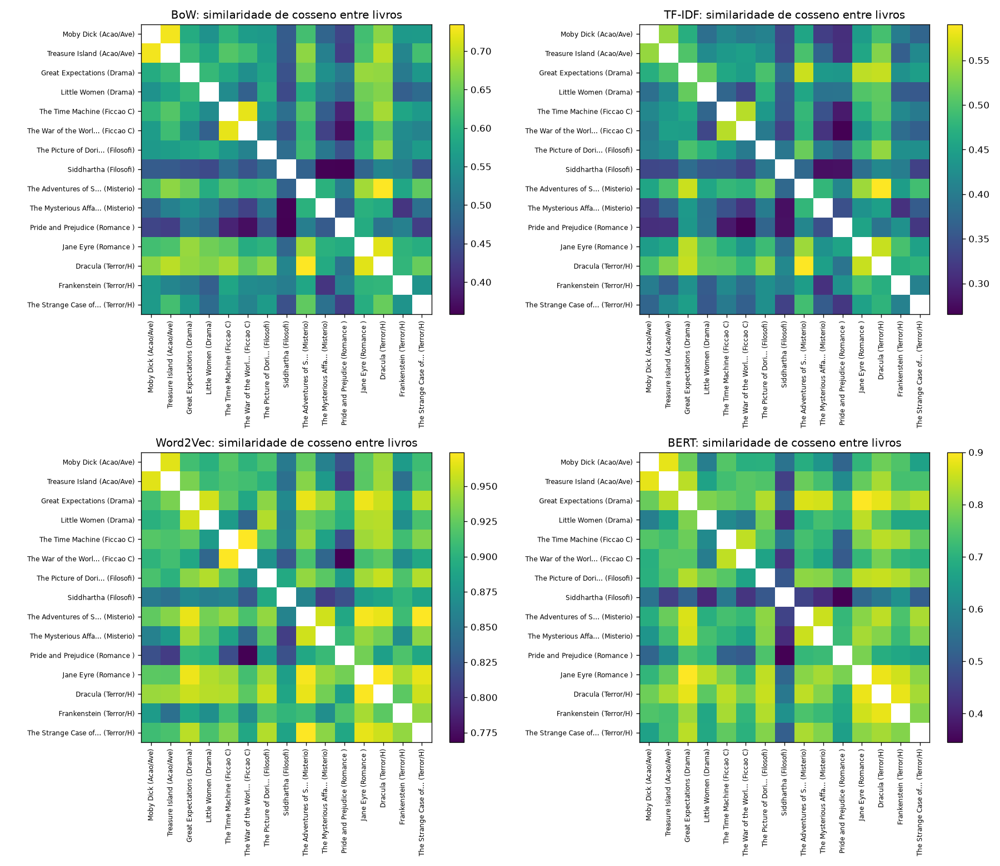

# 3. Recomendação

Acervo = base + holdout: 15 livros, 680 documentos; todo gênero tem ao menos 2 livros. Vetor do livro = média dos seus documentos.

| Representação | Acerto@1 (livro do mesmo gênero) | Acerto@3 | Mais-como-este P@5 (trechos de outros livros) |
|---|---|---|---|
| BoW | 0.533 | 0.600 | 0.212 |
| TF-IDF | 0.467 | 0.667 | 0.214 |
| Word2Vec | 0.467 | 0.800 | 0.334 |
| BERT | 0.400 | 0.733 | 0.220 |

## BoW: 3 livros recomendados

| Livro | Gênero | 1º | 2º | 3º |
|---|---|---|---|---|
| Dracula | Terror/Horror | The Adventures of Sherlock Holmes (Misterio/Policial, 0.73) | Jane Eyre (Romance (amoroso), 0.72) | Treasure Island (Acao/Aventura, 0.70) |
| Frankenstein | Terror/Horror | Dracula (Terror/Horror, 0.61) | Jane Eyre (Romance (amoroso), 0.60) | The Adventures of Sherlock Holmes (Misterio/Policial, 0.58) |
| Great Expectations | Drama | Jane Eyre (Romance (amoroso), 0.68) | Dracula (Terror/Horror, 0.67) | The Adventures of Sherlock Holmes (Misterio/Policial, 0.65) |
| Moby Dick | Acao/Aventura | Treasure Island (Acao/Aventura, 0.73) | Dracula (Terror/Horror, 0.67) | The Adventures of Sherlock Holmes (Misterio/Policial, 0.62) |
| Pride and Prejudice | Romance (amoroso) | Jane Eyre (Romance (amoroso), 0.59) | Frankenstein (Terror/Horror, 0.52) | The Adventures of Sherlock Holmes (Misterio/Policial, 0.52) |
| The Adventures of Sherlock Holmes | Misterio/Policial | Dracula (Terror/Horror, 0.73) | Jane Eyre (Romance (amoroso), 0.68) | Treasure Island (Acao/Aventura, 0.67) |
| The Picture of Dorian Gray | Filosofico/Existencial | Dracula (Terror/Horror, 0.67) | The Adventures of Sherlock Holmes (Misterio/Policial, 0.62) | Jane Eyre (Romance (amoroso), 0.60) |
| The Time Machine | Ficcao Cientifica | The War of the Worlds (Ficcao Cientifica, 0.72) | Dracula (Terror/Horror, 0.68) | Jane Eyre (Romance (amoroso), 0.64) |
| Jane Eyre | Romance (amoroso) | Dracula (Terror/Horror, 0.72) | The Adventures of Sherlock Holmes (Misterio/Policial, 0.68) | Great Expectations (Drama, 0.68) |
| Little Women | Drama | Dracula (Terror/Horror, 0.66) | Jane Eyre (Romance (amoroso), 0.65) | Great Expectations (Drama, 0.61) |
| Siddhartha | Filosofico/Existencial | Dracula (Terror/Horror, 0.53) | Frankenstein (Terror/Horror, 0.52) | The Time Machine (Ficcao Cientifica, 0.50) |
| The Mysterious Affair at Styles | Misterio/Policial | The Adventures of Sherlock Holmes (Misterio/Policial, 0.60) | Jane Eyre (Romance (amoroso), 0.60) | Dracula (Terror/Horror, 0.59) |
| The Strange Case of Dr Jekyll and Mr Hyde | Terror/Horror | Dracula (Terror/Horror, 0.65) | The Adventures of Sherlock Holmes (Misterio/Policial, 0.64) | Treasure Island (Acao/Aventura, 0.62) |
| The War of the Worlds | Ficcao Cientifica | The Time Machine (Ficcao Cientifica, 0.72) | Dracula (Terror/Horror, 0.64) | Treasure Island (Acao/Aventura, 0.62) |
| Treasure Island | Acao/Aventura | Moby Dick (Acao/Aventura, 0.73) | Dracula (Terror/Horror, 0.70) | The Adventures of Sherlock Holmes (Misterio/Policial, 0.67) |

## TF-IDF: 3 livros recomendados

| Livro | Gênero | 1º | 2º | 3º |
|---|---|---|---|---|
| Dracula | Terror/Horror | The Adventures of Sherlock Holmes (Misterio/Policial, 0.59) | Jane Eyre (Romance (amoroso), 0.56) | Great Expectations (Drama, 0.56) |
| Frankenstein | Terror/Horror | Jane Eyre (Romance (amoroso), 0.50) | Dracula (Terror/Horror, 0.47) | The Adventures of Sherlock Holmes (Misterio/Policial, 0.45) |
| Great Expectations | Drama | The Adventures of Sherlock Holmes (Misterio/Policial, 0.56) | Dracula (Terror/Horror, 0.56) | Jane Eyre (Romance (amoroso), 0.56) |
| Moby Dick | Acao/Aventura | Treasure Island (Acao/Aventura, 0.54) | Dracula (Terror/Horror, 0.49) | Great Expectations (Drama, 0.47) |
| Pride and Prejudice | Romance (amoroso) | Jane Eyre (Romance (amoroso), 0.45) | Great Expectations (Drama, 0.44) | Frankenstein (Terror/Horror, 0.43) |
| The Adventures of Sherlock Holmes | Misterio/Policial | Dracula (Terror/Horror, 0.59) | Great Expectations (Drama, 0.56) | Jane Eyre (Romance (amoroso), 0.54) |
| The Picture of Dorian Gray | Filosofico/Existencial | Dracula (Terror/Horror, 0.54) | The Adventures of Sherlock Holmes (Misterio/Policial, 0.52) | Great Expectations (Drama, 0.50) |
| The Time Machine | Ficcao Cientifica | The War of the Worlds (Ficcao Cientifica, 0.56) | Dracula (Terror/Horror, 0.51) | The Adventures of Sherlock Holmes (Misterio/Policial, 0.48) |
| Jane Eyre | Romance (amoroso) | Dracula (Terror/Horror, 0.56) | Great Expectations (Drama, 0.56) | The Adventures of Sherlock Holmes (Misterio/Policial, 0.54) |
| Little Women | Drama | Great Expectations (Drama, 0.51) | Dracula (Terror/Horror, 0.51) | Jane Eyre (Romance (amoroso), 0.50) |
| Siddhartha | Filosofico/Existencial | Dracula (Terror/Horror, 0.42) | Frankenstein (Terror/Horror, 0.40) | The Picture of Dorian Gray (Filosofico/Existencial, 0.39) |
| The Mysterious Affair at Styles | Misterio/Policial | The Adventures of Sherlock Holmes (Misterio/Policial, 0.48) | Dracula (Terror/Horror, 0.45) | Great Expectations (Drama, 0.44) |
| The Strange Case of Dr Jekyll and Mr Hyde | Terror/Horror | The Adventures of Sherlock Holmes (Misterio/Policial, 0.49) | Dracula (Terror/Horror, 0.48) | Jane Eyre (Romance (amoroso), 0.45) |
| The War of the Worlds | Ficcao Cientifica | The Time Machine (Ficcao Cientifica, 0.56) | Dracula (Terror/Horror, 0.48) | The Adventures of Sherlock Holmes (Misterio/Policial, 0.48) |
| Treasure Island | Acao/Aventura | Moby Dick (Acao/Aventura, 0.54) | Dracula (Terror/Horror, 0.53) | Great Expectations (Drama, 0.50) |

## Word2Vec: 3 livros recomendados

| Livro | Gênero | 1º | 2º | 3º |
|---|---|---|---|---|
| Dracula | Terror/Horror | Jane Eyre (Romance (amoroso), 0.97) | The Adventures of Sherlock Holmes (Misterio/Policial, 0.97) | The Strange Case of Dr Jekyll and Mr Hyde (Terror/Horror, 0.96) |
| Frankenstein | Terror/Horror | Jane Eyre (Romance (amoroso), 0.95) | The Strange Case of Dr Jekyll and Mr Hyde (Terror/Horror, 0.94) | Dracula (Terror/Horror, 0.92) |
| Great Expectations | Drama | Jane Eyre (Romance (amoroso), 0.97) | The Adventures of Sherlock Holmes (Misterio/Policial, 0.97) | Little Women (Drama, 0.96) |
| Moby Dick | Acao/Aventura | Treasure Island (Acao/Aventura, 0.96) | Dracula (Terror/Horror, 0.94) | The Adventures of Sherlock Holmes (Misterio/Policial, 0.92) |
| Pride and Prejudice | Romance (amoroso) | Jane Eyre (Romance (amoroso), 0.93) | Frankenstein (Terror/Horror, 0.92) | The Mysterious Affair at Styles (Misterio/Policial, 0.91) |
| The Adventures of Sherlock Holmes | Misterio/Policial | The Strange Case of Dr Jekyll and Mr Hyde (Terror/Horror, 0.97) | Jane Eyre (Romance (amoroso), 0.97) | Dracula (Terror/Horror, 0.97) |
| The Picture of Dorian Gray | Filosofico/Existencial | Dracula (Terror/Horror, 0.96) | The Strange Case of Dr Jekyll and Mr Hyde (Terror/Horror, 0.95) | Little Women (Drama, 0.95) |
| The Time Machine | Ficcao Cientifica | The War of the Worlds (Ficcao Cientifica, 0.97) | Dracula (Terror/Horror, 0.95) | Jane Eyre (Romance (amoroso), 0.94) |
| Jane Eyre | Romance (amoroso) | Dracula (Terror/Horror, 0.97) | The Adventures of Sherlock Holmes (Misterio/Policial, 0.97) | Great Expectations (Drama, 0.97) |
| Little Women | Drama | Great Expectations (Drama, 0.96) | Dracula (Terror/Horror, 0.95) | The Picture of Dorian Gray (Filosofico/Existencial, 0.95) |
| Siddhartha | Filosofico/Existencial | Frankenstein (Terror/Horror, 0.90) | The Picture of Dorian Gray (Filosofico/Existencial, 0.89) | Dracula (Terror/Horror, 0.89) |
| The Mysterious Affair at Styles | Misterio/Policial | The Adventures of Sherlock Holmes (Misterio/Policial, 0.96) | Great Expectations (Drama, 0.95) | Jane Eyre (Romance (amoroso), 0.94) |
| The Strange Case of Dr Jekyll and Mr Hyde | Terror/Horror | The Adventures of Sherlock Holmes (Misterio/Policial, 0.97) | Jane Eyre (Romance (amoroso), 0.97) | Dracula (Terror/Horror, 0.96) |
| The War of the Worlds | Ficcao Cientifica | The Time Machine (Ficcao Cientifica, 0.97) | Dracula (Terror/Horror, 0.92) | The Adventures of Sherlock Holmes (Misterio/Policial, 0.92) |
| Treasure Island | Acao/Aventura | Moby Dick (Acao/Aventura, 0.96) | Dracula (Terror/Horror, 0.94) | The Adventures of Sherlock Holmes (Misterio/Policial, 0.94) |

## BERT: 3 livros recomendados

| Livro | Gênero | 1º | 2º | 3º |
|---|---|---|---|---|
| Dracula | Terror/Horror | Jane Eyre (Romance (amoroso), 0.88) | Frankenstein (Terror/Horror, 0.88) | Great Expectations (Drama, 0.88) |
| Frankenstein | Terror/Horror | Dracula (Terror/Horror, 0.88) | Jane Eyre (Romance (amoroso), 0.86) | The Picture of Dorian Gray (Filosofico/Existencial, 0.84) |
| Great Expectations | Drama | Jane Eyre (Romance (amoroso), 0.90) | Dracula (Terror/Horror, 0.88) | The Adventures of Sherlock Holmes (Misterio/Policial, 0.87) |
| Moby Dick | Acao/Aventura | Treasure Island (Acao/Aventura, 0.88) | Dracula (Terror/Horror, 0.78) | Great Expectations (Drama, 0.77) |
| Pride and Prejudice | Romance (amoroso) | Jane Eyre (Romance (amoroso), 0.79) | The Picture of Dorian Gray (Filosofico/Existencial, 0.75) | Great Expectations (Drama, 0.74) |
| The Adventures of Sherlock Holmes | Misterio/Policial | Great Expectations (Drama, 0.87) | The Mysterious Affair at Styles (Misterio/Policial, 0.85) | Dracula (Terror/Horror, 0.85) |
| The Picture of Dorian Gray | Filosofico/Existencial | Dracula (Terror/Horror, 0.85) | Jane Eyre (Romance (amoroso), 0.85) | Great Expectations (Drama, 0.84) |
| The Time Machine | Ficcao Cientifica | The War of the Worlds (Ficcao Cientifica, 0.85) | Dracula (Terror/Horror, 0.84) | Frankenstein (Terror/Horror, 0.83) |
| Jane Eyre | Romance (amoroso) | Great Expectations (Drama, 0.90) | Dracula (Terror/Horror, 0.88) | Frankenstein (Terror/Horror, 0.86) |
| Little Women | Drama | Jane Eyre (Romance (amoroso), 0.84) | Great Expectations (Drama, 0.79) | The Picture of Dorian Gray (Filosofico/Existencial, 0.78) |
| Siddhartha | Filosofico/Existencial | Frankenstein (Terror/Horror, 0.63) | Dracula (Terror/Horror, 0.57) | The Time Machine (Ficcao Cientifica, 0.57) |
| The Mysterious Affair at Styles | Misterio/Policial | Great Expectations (Drama, 0.86) | The Adventures of Sherlock Holmes (Misterio/Policial, 0.85) | Jane Eyre (Romance (amoroso), 0.82) |
| The Strange Case of Dr Jekyll and Mr Hyde | Terror/Horror | Great Expectations (Drama, 0.84) | The Adventures of Sherlock Holmes (Misterio/Policial, 0.83) | Dracula (Terror/Horror, 0.82) |
| The War of the Worlds | Ficcao Cientifica | The Time Machine (Ficcao Cientifica, 0.85) | Dracula (Terror/Horror, 0.79) | Treasure Island (Acao/Aventura, 0.76) |
| Treasure Island | Acao/Aventura | Moby Dick (Acao/Aventura, 0.88) | Great Expectations (Drama, 0.84) | Dracula (Terror/Horror, 0.83) |
