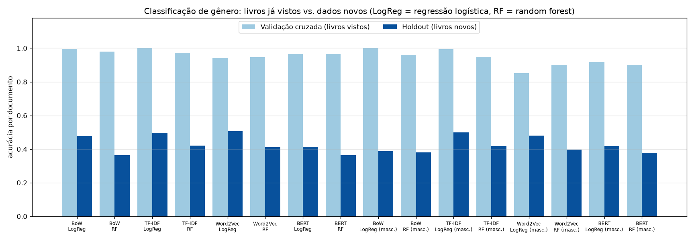
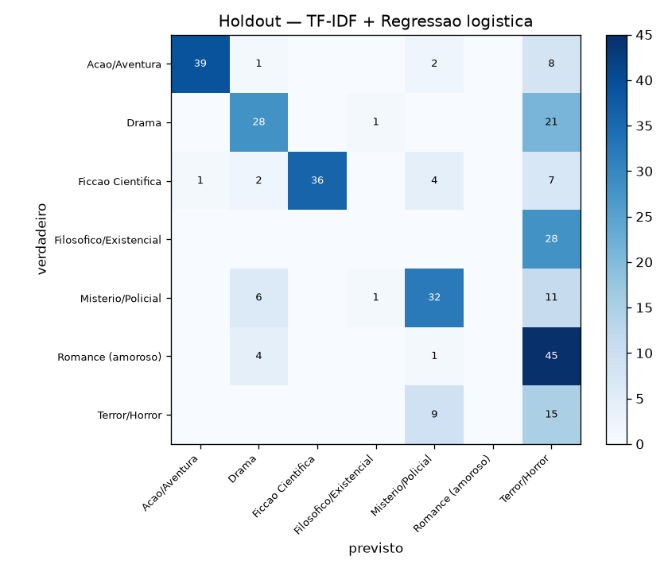
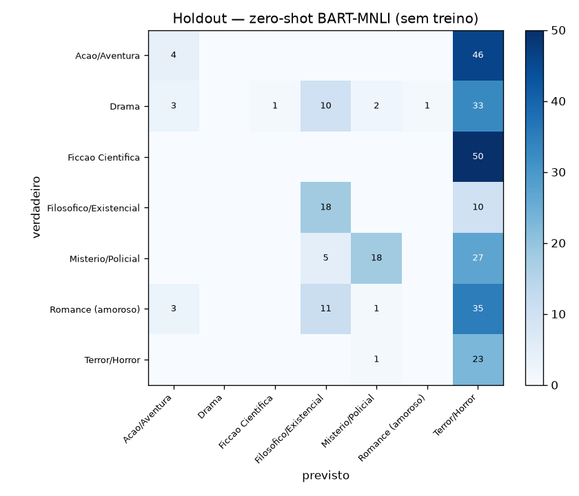
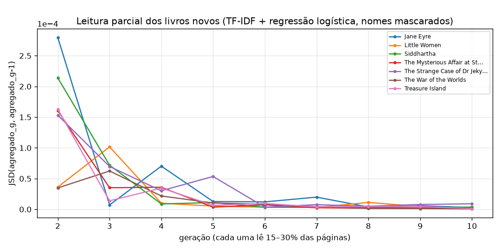

# 4. Classificação de gênero

Treino: 378 documentos da base (7 gêneros). Teste com dados novos: 302 documentos de 7 livros nunca vistos (Jane Eyre (50), Little Women (50), Siddhartha (28), The Mysterious Affair at Styles (50), The Strange Case of Dr Jekyll and Mr Hyde (24), The War of the Worlds (50), Treasure Island (50)).

- **Validação cruzada**: 5 folds estratificados na base (documentos do mesmo livro no treino e no teste).
- **Holdout**: treino na base inteira, teste nos livros novos. Representações ajustadas só na base.
- **Masc.**: nomes próprios substituídos por "X" (detectados livro a livro por `proper_noun_vocabulary`).
- **Leitura parcial**: 10 gerações por livro novo, cada uma lendo 15–30% das páginas, interpoladas com `aggregation.aggregate` (laço da Unidade 1 com amostragem uniforme).

| Representação | Modelo | Masc. | Acc. CV | F1 CV | Acc. holdout | F1 holdout | Livros top-1 (/7) | Livros top-3 | Leitura parcial top-1 |
|---|---|---|---|---|---|---|---|---|---|
| BoW | Regressao logistica | não | 0.997 | 0.997 | 0.477 | 0.445 | 4 | 7 | 4 |
| BoW | Random Forest | não | 0.979 | 0.983 | 0.364 | 0.358 | 3 | 6 | — |
| TF-IDF | Regressao logistica | não | 1.000 | 1.000 | 0.497 | 0.452 | 4 | 6 | 4 |
| TF-IDF | Random Forest | não | 0.974 | 0.979 | 0.421 | 0.404 | 3 | 7 | — |
| Word2Vec | Regressao logistica | não | 0.942 | 0.944 | 0.507 | 0.438 | 5 | 6 | 5 |
| Word2Vec | Random Forest | não | 0.947 | 0.949 | 0.411 | 0.377 | 4 | 6 | — |
| BERT | Regressao logistica | não | 0.966 | 0.966 | 0.414 | 0.385 | 5 | 6 | 4 |
| BERT | Random Forest | não | 0.966 | 0.969 | 0.364 | 0.349 | 4 | 5 | — |
| BoW | Regressao logistica | sim | 1.000 | 1.000 | 0.387 | 0.351 | 4 | 7 | 4 |
| BoW | Random Forest | sim | 0.960 | 0.966 | 0.381 | 0.379 | 3 | 7 | — |
| TF-IDF | Regressao logistica | sim | 0.995 | 0.996 | 0.500 | 0.448 | 5 | 6 | 5 |
| TF-IDF | Random Forest | sim | 0.950 | 0.957 | 0.417 | 0.386 | 3 | 7 | — |
| Word2Vec | Regressao logistica | sim | 0.852 | 0.858 | 0.480 | 0.431 | 4 | 6 | 4 |
| Word2Vec | Random Forest | sim | 0.902 | 0.908 | 0.397 | 0.366 | 3 | 6 | — |
| BERT | Regressao logistica | sim | 0.918 | 0.921 | 0.417 | 0.395 | 3 | 6 | 3 |
| BERT | Random Forest | sim | 0.902 | 0.907 | 0.377 | 0.369 | 3 | 6 | — |

## Referências sem treino (pipeline da Unidade 1)

| Método | Acc. holdout (7 gêneros) | F1 holdout | Acc. (14 gêneros) | Livros top-1 | Livros top-3 | Previsões |
|---|---|---|---|---|---|---|
| lexico_tfidf | 0.381 | 0.368 | 0.215 | 4 | 7 | Romance (amoroso): 66, Drama: 54, Acao/Aventura: 53, Terror/Horror: 42, Filosofico/Existencial: 35, Misterio/Policial: 32, Ficcao Cientifica: 20 |
| zeroshot_bart_mnli | 0.209 | 0.188 | 0.086 | 2 | 4 | Terror/Horror: 224, Filosofico/Existencial: 44, Misterio/Policial: 22, Acao/Aventura: 10, Romance (amoroso): 1, Ficcao Cientifica: 1 |

## Matriz de confusão — melhor configuração no holdout (TF-IDF + Regressao logistica)

## Veredito por livro novo

| Livro | Gênero | bow/logreg | bow/random_forest | tfidf/logreg | tfidf/random_forest | word2vec/logreg | word2vec/random_forest | bert/logreg | bert/random_forest | bow/logreg/masc | bow/random_forest/masc | tfidf/logreg/masc | tfidf/random_forest/masc | word2vec/logreg/masc | word2vec/random_forest/masc | bert/logreg/masc | bert/random_forest/masc | lexico_tfidf | zeroshot_bart_mnli |
|---|---|---|---|---|---|---|---|---|---|---|---|---|---|---|---|---|---|---|---|
| Jane Eyre | Romance (amoroso) | ✘ Terror/Horror | ✘ Terror/Horror | ✘ Terror/Horror | ✘ Terror/Horror | ✘ Terror/Horror | ✘ Terror/Horror | ✘ Drama | ✘ Terror/Horror | ✔ Romance (amoroso) | ✘ Terror/Horror | ✘ Terror/Horror | ✘ Terror/Horror | ✘ Terror/Horror | ✘ Terror/Horror | ✘ Drama | ✘ Drama | ✔ Romance (amoroso) | ✘ Terror/Horror |
| Little Women | Drama | ✘ Terror/Horror | ✘ Terror/Horror | ✘ Terror/Horror | ✘ Terror/Horror | ✔ Drama | ✘ Terror/Horror | ✔ Drama | ✔ Drama | ✘ Romance (amoroso) | ✘ Romance (amoroso) | ✔ Drama | ✘ Romance (amoroso) | ✔ Drama | ✔ Drama | ✘ Filosofico/Existencial | ✘ Filosofico/Existencial | ✘ Romance (amoroso) | ✘ Terror/Horror |
| Siddhartha | Filosofico/Existencial | ✘ Terror/Horror | ✘ Terror/Horror | ✘ Terror/Horror | ✘ Terror/Horror | ✘ Terror/Horror | ✘ Terror/Horror | ✘ Terror/Horror | ✘ Terror/Horror | ✘ Terror/Horror | ✘ Terror/Horror | ✘ Terror/Horror | ✘ Terror/Horror | ✘ Terror/Horror | ✘ Terror/Horror | ✘ Terror/Horror | ✘ Terror/Horror | ✘ Romance (amoroso) | ✔ Filosofico/Existencial |
| The Mysterious Affair at Styles | Misterio/Policial | ✔ Misterio/Policial | ✘ Terror/Horror | ✔ Misterio/Policial | ✘ Terror/Horror | ✔ Misterio/Policial | ✔ Misterio/Policial | ✔ Misterio/Policial | ✔ Misterio/Policial | ✘ Romance (amoroso) | ✘ Romance (amoroso) | ✔ Misterio/Policial | ✘ Romance (amoroso) | ✔ Misterio/Policial | ✘ Drama | ✔ Misterio/Policial | ✔ Misterio/Policial | ✔ Misterio/Policial | ✘ Terror/Horror |
| The Strange Case of Dr Jekyll and Mr Hyde | Terror/Horror | ✔ Terror/Horror | ✔ Terror/Horror | ✔ Terror/Horror | ✔ Terror/Horror | ✔ Terror/Horror | ✔ Terror/Horror | ✔ Terror/Horror | ✘ Drama | ✔ Terror/Horror | ✔ Terror/Horror | ✔ Terror/Horror | ✔ Terror/Horror | ✘ Misterio/Policial | ✘ Misterio/Policial | ✘ Misterio/Policial | ✘ Misterio/Policial | ✘ Filosofico/Existencial | ✔ Terror/Horror |
| The War of the Worlds | Ficcao Cientifica | ✔ Ficcao Cientifica | ✔ Ficcao Cientifica | ✔ Ficcao Cientifica | ✔ Ficcao Cientifica | ✔ Ficcao Cientifica | ✔ Ficcao Cientifica | ✔ Ficcao Cientifica | ✔ Ficcao Cientifica | ✔ Ficcao Cientifica | ✔ Ficcao Cientifica | ✔ Ficcao Cientifica | ✔ Ficcao Cientifica | ✔ Ficcao Cientifica | ✔ Ficcao Cientifica | ✔ Ficcao Cientifica | ✔ Ficcao Cientifica | ✔ Ficcao Cientifica | ✘ Terror/Horror |
| Treasure Island | Acao/Aventura | ✔ Acao/Aventura | ✔ Acao/Aventura | ✔ Acao/Aventura | ✔ Acao/Aventura | ✔ Acao/Aventura | ✔ Acao/Aventura | ✔ Acao/Aventura | ✔ Acao/Aventura | ✔ Acao/Aventura | ✔ Acao/Aventura | ✔ Acao/Aventura | ✔ Acao/Aventura | ✔ Acao/Aventura | ✔ Acao/Aventura | ✔ Acao/Aventura | ✔ Acao/Aventura | ✔ Acao/Aventura | ✘ Terror/Horror |

## Termos de maior peso por gênero (TF-IDF + regressão logística)

| Gênero | Sem mascarar nomes | Nomes mascarados |
|---|---|---|
| Acao/Aventura | whale, queequeg, ship, captain, whaling, sea, ahab, peleg, whales, thou | whale, ship, captain, chapter, whaling, sea, thou, whales, voyage, harpooneer |
| Drama | joe, havisham, pip, pumblechook, estella, biddy, wopsle, sister, boy, pocket | sister, boy, kitchen, pocket, marshes, forge, gate, returned, gentleman, don |
| Ficcao Cientifica | machine, traveller, weena, morlocks, sphinx, psychologist, filby, bronze, editor, medical | machine, sphinx, space, palace, bronze, lever, white, travelling, matches, dimensions |
| Filosofico/Existencial | dorian, gray, henry, harry, basil, lord, hallward, sibyl, don, vane | don, lad, art, life, portrait, picture, wonderful, murmured, painter, charming |
| Misterio/Policial | holmes, sherlock, watson, street, case, police, remarked, matter, doctor, baker | street, case, police, remarked, doctor, matter, visitor, singular, stepfather, miss |
| Romance (amoroso) | bennet, bingley, darcy, elizabeth, jane, collins, illustration, miss, mrs, lucas | herself, ladies, sisters, daughters, agreeable, girls, party, replied, lady, ball |
| Terror/Horror | lucy, helsing, van, arthur, count, whilst, jonathan, mina, sleep, heart | whilst, sleep, diary, heart, poor, cause, around, castle, death, sweet |

## Leitura parcial (15–30% das páginas por geração)

| Representação | Masc. | Livro | Gênero | Previsto | Top-3 | JSD final |
|---|---|---|---|---|---|---|
| BoW | não | Jane Eyre | Romance (amoroso) | Terror/Horror | terror, drama, romance | 0.000 |
| BoW | não | Little Women | Drama | Terror/Horror | terror, drama, filosofico | 0.000 |
| BoW | não | Siddhartha | Filosofico/Existencial | Terror/Horror | terror, ficcao_cientifica, filosofico | 0.000 |
| BoW | não | The Mysterious Affair at Styles | Misterio/Policial | Misterio/Policial | misterio, drama, romance | 0.000 |
| BoW | não | The Strange Case of Dr Jekyll and Mr Hyde | Terror/Horror | Terror/Horror | terror, misterio, drama | 0.000 |
| BoW | não | The War of the Worlds | Ficcao Cientifica | Ficcao Cientifica | ficcao_cientifica, terror, misterio | 0.000 |
| BoW | não | Treasure Island | Acao/Aventura | Acao/Aventura | acao, terror, ficcao_cientifica | 0.000 |
| TF-IDF | não | Jane Eyre | Romance (amoroso) | Terror/Horror | terror, drama, misterio | 0.000 |
| TF-IDF | não | Little Women | Drama | Terror/Horror | terror, drama, filosofico | 0.000 |
| TF-IDF | não | Siddhartha | Filosofico/Existencial | Terror/Horror | terror, filosofico, drama | 0.000 |
| TF-IDF | não | The Mysterious Affair at Styles | Misterio/Policial | Misterio/Policial | misterio, terror, drama | 0.000 |
| TF-IDF | não | The Strange Case of Dr Jekyll and Mr Hyde | Terror/Horror | Terror/Horror | terror, misterio, drama | 0.000 |
| TF-IDF | não | The War of the Worlds | Ficcao Cientifica | Ficcao Cientifica | ficcao_cientifica, terror, misterio | 0.000 |
| TF-IDF | não | Treasure Island | Acao/Aventura | Acao/Aventura | acao, terror, drama | 0.000 |
| Word2Vec | não | Jane Eyre | Romance (amoroso) | Terror/Horror | terror, misterio, ficcao_cientifica | 0.000 |
| Word2Vec | não | Little Women | Drama | Drama | drama, filosofico, terror | 0.000 |
| Word2Vec | não | Siddhartha | Filosofico/Existencial | Terror/Horror | terror, filosofico, ficcao_cientifica | 0.000 |
| Word2Vec | não | The Mysterious Affair at Styles | Misterio/Policial | Misterio/Policial | misterio, drama, terror | 0.000 |
| Word2Vec | não | The Strange Case of Dr Jekyll and Mr Hyde | Terror/Horror | Terror/Horror | terror, misterio, drama | 0.000 |
| Word2Vec | não | The War of the Worlds | Ficcao Cientifica | Ficcao Cientifica | ficcao_cientifica, terror, misterio | 0.000 |
| Word2Vec | não | Treasure Island | Acao/Aventura | Acao/Aventura | acao, terror, misterio | 0.000 |
| BERT | não | Jane Eyre | Romance (amoroso) | Terror/Horror | terror, drama, romance | 0.000 |
| BERT | não | Little Women | Drama | Drama | drama, filosofico, terror | 0.000 |
| BERT | não | Siddhartha | Filosofico/Existencial | Terror/Horror | terror, acao, ficcao_cientifica | 0.000 |
| BERT | não | The Mysterious Affair at Styles | Misterio/Policial | Drama | drama, misterio, filosofico | 0.000 |
| BERT | não | The Strange Case of Dr Jekyll and Mr Hyde | Terror/Horror | Terror/Horror | terror, drama, misterio | 0.000 |
| BERT | não | The War of the Worlds | Ficcao Cientifica | Ficcao Cientifica | ficcao_cientifica, terror, drama | 0.000 |
| BERT | não | Treasure Island | Acao/Aventura | Acao/Aventura | acao, drama, terror | 0.000 |
| BoW | sim | Jane Eyre | Romance (amoroso) | Romance (amoroso) | romance, terror, drama | 0.000 |
| BoW | sim | Little Women | Drama | Romance (amoroso) | romance, drama, terror | 0.000 |
| BoW | sim | Siddhartha | Filosofico/Existencial | Terror/Horror | terror, filosofico, romance | 0.001 |
| BoW | sim | The Mysterious Affair at Styles | Misterio/Policial | Romance (amoroso) | romance, misterio, terror | 0.000 |
| BoW | sim | The Strange Case of Dr Jekyll and Mr Hyde | Terror/Horror | Terror/Horror | terror, misterio, romance | 0.000 |
| BoW | sim | The War of the Worlds | Ficcao Cientifica | Ficcao Cientifica | ficcao_cientifica, terror, romance | 0.000 |
| BoW | sim | Treasure Island | Acao/Aventura | Acao/Aventura | acao, terror, misterio | 0.000 |
| TF-IDF | sim | Jane Eyre | Romance (amoroso) | Terror/Horror | terror, drama, misterio | 0.000 |
| TF-IDF | sim | Little Women | Drama | Drama | drama, terror, filosofico | 0.000 |
| TF-IDF | sim | Siddhartha | Filosofico/Existencial | Terror/Horror | terror, filosofico, drama | 0.000 |
| TF-IDF | sim | The Mysterious Affair at Styles | Misterio/Policial | Misterio/Policial | misterio, terror, drama | 0.000 |
| TF-IDF | sim | The Strange Case of Dr Jekyll and Mr Hyde | Terror/Horror | Terror/Horror | terror, misterio, drama | 0.000 |
| TF-IDF | sim | The War of the Worlds | Ficcao Cientifica | Ficcao Cientifica | ficcao_cientifica, terror, misterio | 0.000 |
| TF-IDF | sim | Treasure Island | Acao/Aventura | Acao/Aventura | acao, terror, drama | 0.000 |
| Word2Vec | sim | Jane Eyre | Romance (amoroso) | Terror/Horror | terror, misterio, drama | 0.000 |
| Word2Vec | sim | Little Women | Drama | Drama | drama, filosofico, terror | 0.000 |
| Word2Vec | sim | Siddhartha | Filosofico/Existencial | Terror/Horror | terror, filosofico, drama | 0.000 |
| Word2Vec | sim | The Mysterious Affair at Styles | Misterio/Policial | Misterio/Policial | misterio, drama, terror | 0.000 |
| Word2Vec | sim | The Strange Case of Dr Jekyll and Mr Hyde | Terror/Horror | Misterio/Policial | misterio, terror, drama | 0.000 |
| Word2Vec | sim | The War of the Worlds | Ficcao Cientifica | Ficcao Cientifica | ficcao_cientifica, terror, misterio | 0.000 |
| Word2Vec | sim | Treasure Island | Acao/Aventura | Acao/Aventura | acao, drama, misterio | 0.000 |
| BERT | sim | Jane Eyre | Romance (amoroso) | Drama | drama, terror, filosofico | 0.000 |
| BERT | sim | Little Women | Drama | Filosofico/Existencial | filosofico, drama, romance | 0.000 |
| BERT | sim | Siddhartha | Filosofico/Existencial | Terror/Horror | terror, filosofico, acao | 0.000 |
| BERT | sim | The Mysterious Affair at Styles | Misterio/Policial | Misterio/Policial | misterio, drama, filosofico | 0.000 |
| BERT | sim | The Strange Case of Dr Jekyll and Mr Hyde | Terror/Horror | Misterio/Policial | misterio, terror, drama | 0.000 |
| BERT | sim | The War of the Worlds | Ficcao Cientifica | Ficcao Cientifica | ficcao_cientifica, misterio, terror | 0.000 |
| BERT | sim | Treasure Island | Acao/Aventura | Acao/Aventura | acao, drama, misterio | 0.000 |
