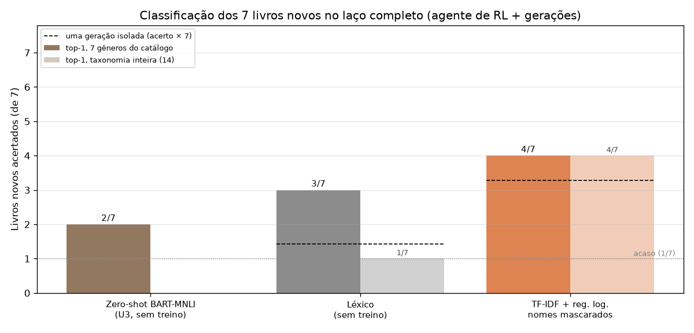
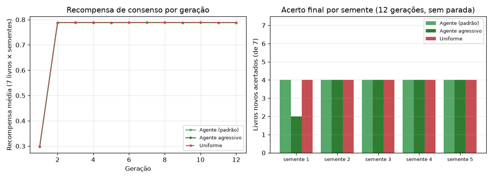

# Unidade 4: resultados do laço completo

Referência: gênero curado (`catalog.py`). Holdout = 7 livros nunca vistos no treino.

| Método | Top-1 (14 gêneros) | Top-1 (7 do catálogo) | Top-3 (14) | Acerto por geração | Gerações (média) | Fração do livro lida |
|---|---|---|---|---|---|---|
| Léxico TF-IDF (sem treino) | 1 | 3 | 6 | 0,204 | 7,000 | 0,825 |
| TF-IDF + reg. logística (nomes mascarados) | 4 | 4 | 6 | 0,469 | 7,000 | 0,825 |

## Agente de RL x amostragem uniforme

| Estratégia | Livros top-1 (média de 7) | Acerto por geração | Recompensa média | Entropia da política | P máx. de um segmento |
|---|---|---|---|---|---|
| bandit | 4,000 | 0,517 | 0,748 | 0,999 | 0,112 |
| bandit_agressivo | 3,600 | 0,495 | 0,748 | 0,926 | 0,242 |
| uniform | 4,000 | 0,517 | 0,748 | 1,000 | 0,100 |
